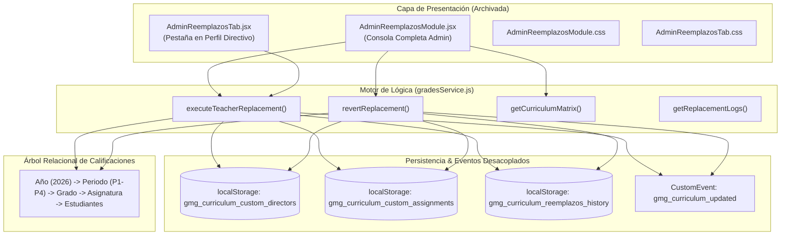

# 📋 Documentación Técnica y Lógica: Módulo "Novedades & Reemplazos Docentes"

> **Estado del Módulo:** 🔴 **Clausurado / Retirado de la Interfaz Visual (Archivado Técnico)**  
> **Fecha de Clausura:** Octubre 2026  
> **Directiva Administrativa:** El módulo ha sido completamente retirado y ocultado de la interfaz gráfica y flujo de navegación por solicitud directiva ("enfoque preliminar desalineado con las prioridades operativas actuales").  
> **Propósito de este Documento:** Preservar la memoria técnica, la arquitectura relacional, la lógica del motor de contingencias y el histórico de decisiones para futuras revisiones o rediseños cuando la institución así lo disponga.

---

## 1. 🎯 Justificación y Planteamiento Original

El módulo de **Novedades & Reemplazos Docentes** surgió para abordar una contingencia crítica en la gestión académica escolar:
- Cuando una docente titular enfrenta una **incapacidad médica (EPS), licencia de maternidad/paternidad, permiso institucional urgente o calamidad doméstica**, la institución debe asignar de inmediato un docente de reemplazo.
- **El reto con el SIEE (Sistema Institucional de Evaluación de los Estudiantes):**  
  En un sistema estático o rígidamente acoplado, cambiar el docente responsable implicaba borrar o bloquear el acceso a las calificaciones acumuladas del periodo. El docente sustituto requería:
  1. Acceso inmediato a la planilla de calificaciones del grado asignado.
  2. Capacidad de ingresar y modificar notas sobre los registros ya existentes sin sobreescribir ni dañar el historial previo del docente titular.
  3. Reasumir (opcionalmente) la **Dirección de Curso** para la emisión de consolidados y atención de acudientes.
  4. Garantizar un procedimiento de **restitución o reincorporación inmediata** una vez finalizada la incapacidad, devolviendo el control al titular con total trazabilidad.

---

## 2. 🏗️ Arquitectura y Componentes Desarrollados

El desarrollo abarcó componentes de interfaz, capas de presentación y un motor de datos integrado a `gradesService.js`:



### 2.1. Componentes de Interfaz
1. **`AdminReemplazosModule.jsx`:**
   - **Vista:** Pantalla completa y espaciosa exclusiva para el Administrador con paleta institucional verde esmeralda y cyan.
   - **Métricas Superiores:** Grados activos (6: Transición a 5° Primaria), Directores de Curso, Novedades Activas y Asignaturas cubiertas (100%).
   - **Formulario Riguroso (Acta de Contingencia):**
     - Selector de grado a intervenir.
     - Causa formal: Incapacidad médica EPS, Licencia maternidad/paternidad, Permiso institucional, Calamidad doméstica o Motivo personalizado.
     - Selector dual con flecha direccional: *Docente Saliente / Incapacitado* ➡️ *Docente Nombrado (Reemplazo)*.
     - Alcance configurable:
       - ☑️ *Asumir Dirección de Curso*: Otorga supervisión de la sábana general de notas y atención a padres.
       - ☑️ *Transferir asignaturas y planillas*: Modifica la propiedad de las materias del grado sin pérdida de notas.
     - Generador automático de número de acta (`ACTA-2026-XXX`).
   - **Matriz Curricular en Tiempo Real:** Visualización de los 6 grados con sus directores titulares/reemplazados y chips de colores por materia indicando docente a cargo y etiqueta de reemplazo activo (`★`).
   - **Libro de Actas & Auditoría:** Tabla detallada con timestamp, grado, saliente, entrante, motivo, acta, autorizante y botón de un clic para **"Reincorporar Titular"**.

2. **`AdminReemplazosTab.jsx`:**
   - Versión compacta diseñada para incrustarse en el modal de perfil (`ProfileModal.jsx`).

---

## 3. ⚙️ Lógica Técnica y Motor de Datos

Toda la lógica de reemplazo reside en el servicio singleton `src/services/gradesService.js`:

### 3.1. Estado Curricular Dinámico vs. Datos Estáticos Base
- Las asignaciones base institucionales provienen de `src/data/gradesTreeData.js`:
  - `GRADE_DIRECTORS`: Define el director titular de cada grado (ej. Transición: Jessica, 1°: Yuri, etc.).
  - `TEACHER_CURRICULUM_ASSIGNMENTS`: Mapea cada materia de cada grado a su docente titular.
- Para no mutar irreversiblemente los archivos base, el servicio utiliza **capas de sobreescritura (runtime overrides)**:
  ```javascript
  this.customDirectors = JSON.parse(localStorage.getItem('gmg_curriculum_custom_directors') || '{}');
  this.customAssignments = JSON.parse(localStorage.getItem('gmg_curriculum_custom_assignments') || '{}');
  this.replacementLogs = JSON.parse(localStorage.getItem('gmg_curriculum_reemplazos_history') || '[]');
  ```

### 3.2. Ejecución Atómica de Reemplazo (`executeTeacherReplacement`)
Al ejecutarse un reemplazo:
1. **Reemplazo de Director:**
   - Si `replaceDirector === true`, se actualiza `this.customDirectors[grade]` con el nuevo `docente_id`, el motivo y la estampa temporal.
2. **Reemplazo de Asignaturas y Planillas:**
   - Si `replaceSubjects === true`, se recorren las asignaturas del grado.
   - Las materias a cargo de la docente saliente se transfieren a `this.customAssignments[grade][subj]`.
   - **Propagación en el Árbol Relacional de Notas:**
     ```javascript
     ACADEMIC_YEARS.forEach(y => {
       ACADEMIC_PERIODS.forEach(p => {
         if (this.tree[y]?.[p]?.[grade]?.[subj]) {
           this.tree[y][p][grade][subj].docente_id = newDocenteKey;
           this.tree[y][p][grade][subj].teacherName = newTeacherObj.name;
           this.tree[y][p][grade][subj].lastReplacedFrom = currentAssign.docente_id;
           this.tree[y][p][grade][subj].lastUpdated = now;
           this.tree[y][p][grade][subj].lastUpdatedBy = `Reemplazo Administrador: ${newTeacherObj.name}`;
         }
       });
     });
     ```
   - **Garantía SIEE:** El array `students` con las notas existentes (`c1, c2, c3, definitiva, feedback`) permanece intacto. El nuevo docente puede continuar digitando sin reiniciar el periodo.
3. **Registro en el Libro de Actas:**
   - Se crea un registro inmutable con identificador único (`REP-${Date.now()}`), estado `'activo'`, número de acta y responsable.
4. **Persistencia y Emisión de Evento:**
   - Se guarda en `localStorage` y se dispara `window.dispatchEvent(new CustomEvent('gmg_curriculum_updated'))`. Esto permitía que cualquier módulo abierto sincronizara sus vistas de inmediato.

### 3.3. Mecanismo de Reincorporación (`revertReplacement`)
Cuando la docente titular finaliza su incapacidad médica o licencia:
1. El Administrador presionaba **"Reincorporar Titular"** en el Libro de Actas.
2. Si la docente previa era la titular original por defecto (`GRADE_DIRECTORS`), se eliminaba la entrada en `this.customDirectors[grade]`, volviendo limpiamente a la configuración predeterminada.
3. Se restauraban las materias en `this.customAssignments[grade]` y en todos los periodos del árbol relacional.
4. El log cambiaba de estado a `'finalizado'`, con fecha y firma de reincorporación (`revertedBy`, `revertedAt`).
5. Las notas añadidas por la docente de reemplazo durante su periodo de suplencia **se conservan completamente**, de modo que la titular puede ver lo evaluado durante su ausencia.

---

## 4. 🚫 Motivo de la Clausura y Retiro Visual

El usuario y la dirección institucional manifestaron:
> *"clausura el novedades y reemplazos. siento que lo encamine mal. no lo muestres, pero crea un md con lo que se hizo, y la logica detras, recuerda que no lo quiero mostrar"*

### Razones Clave de la Decisión:
1. **Sobredimensión Administrativa Temprana:** Se diseñó una consola formal con libros de actas y flujos notariales que resultaba excesiva y burocrática para la operatividad diaria de la institución en su etapa actual.
2. **Prioridad en el Flujo Pedagógico Principal:** El enfoque central debe mantenerse en el diligenciamiento fluido de notas SIEE, el Observador del Estudiante y la gestión documental de recursos y circulares.
3. **Fricción de Roles:** La reasignación de materias y directores puede manejarse de formas más directas y naturales sin exigir un módulo independiente con terminología de reemplazos y actas.

---

## 5. 🔒 Acciones de Clausura Aplicadas en el Código

Para asegurar que **NO se muestre** en ningún lugar del sistema:
- **`ModulesDashboard.jsx`:**
  - Se eliminó el botón de acceso de la barra lateral izquierda ("Novedades & Reemplazos").
  - Se eliminaron las tarjetas de la cuadrícula principal (tanto la interactiva del Administrador como la tarjeta en gris de fase de desarrollo de la Rectora).
  - La función `handleModuleClick` descarta y cancela cualquier invocación con `moduleId === 'reemplazos'`.
- **`App.jsx`:**
  - Se retiró la importación y la ruta completa de renderizado de `AdminReemplazosModule`.
  - Si el estado `activeModule` recibe `'reemplazos'`, se redirige automáticamente al Dashboard (`null`).
  - Se retiró el callback `onNavigateToReemplazos` que se pasaba a `GradesModule`.
- **`ProfileModal.jsx`:**
  - Se eliminaron los botones y contenedores comentados de la pestaña de reemplazos.
- **`readme.md`:**
  - Se actualizó el índice de módulos del proyecto marcando el estado de archivo de esta funcionalidad y enlazando a la presente documentación.

---

## 6. 💡 Lecciones y Opciones para una Futura Implementación

Si en el futuro la institución decide reintroducir la cobertura de ausencias docentes, se recomienda:
1. **Enfoque Integrado en la Planilla (Sin Módulo Separado):** En lugar de un módulo dedicado, permitir que la Rectora o Administrador asigne un "Docente Co-titular" o "Docente Temporal" directamente desde la barra de grados de Notas.
2. **Modo Suplente Simple:** Habilitar un interruptor en el perfil de la profesora ("Asignar permisos temporales a: Jessica") que expire en una fecha determinada.
3. **Reutilización del Código:** Todo el motor de cálculo relacional y mutación de asignaciones en `gradesService.js` sigue estando disponible y validado algorítmicamente para cuando se requiera.
