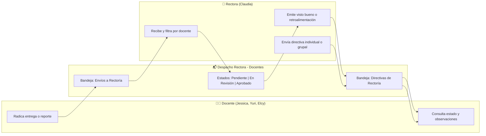

# 📋 Especificación y Propuesta: Módulo "Despacho Rectora - Docentes"

> **Estado del Módulo:** 🟡 **En Espera de Validación Directiva**  
> **Nota de Implementación:** Este documento define la arquitectura, diseño de interfaz y modelo de datos propuesto. **No se implementará código hasta que la Rectora (Claudia) valide sus necesidades específicas.**

---

## 1. 🎯 Objetivo y Justificación

Actualmente, las profesoras suben planeaciones, calificaciones y talleres que quedan visibles en sus respectivas carpetas temáticas. Sin embargo, en el día a día escolar existen **entregas formales y solicitudes directas dirigidas a la Rectoría**, así como **devoluciones, retroalimentaciones o directivas específicas que la Rectora envía a las profesoras**.

Este módulo tiene como propósito:
1. **Desacoplar la correspondencia formal y administrativa** del material pedagógico común.
2. **Organizar el flujo bidireccional:**
   - *Docente ➡️ Rectora:* Entregas formales, informes, solicitudes de permiso y reportes.
   - *Rectora ➡️ Docente:* Respuestas, retroalimentaciones, aprobaciones y directivas específicas a una o varias profesoras.
3. **Ofrecer trazabilidad institucional:** Saber qué docente envió qué documento, en qué fecha, si la Rectora ya lo revisó y si dejó observaciones.

---

## 2. 🔄 Flujos de Trabajo Propuestos

---

## 3. 🎨 Propuesta de Interfaz (UI / UX)

### A. Ubicación en el Menú Lateral (`Sidebar.jsx`)
- Nuevo ítem en la barra lateral:
  - **Ícono:** `ph-duotone ph-chats-circle` o `ph-duotone ph-tray`
  - **Título:** `Despacho Rectora - Docentes`
  - **Badge de novedades:** Globo contador de documentos pendientes de revisión (para la Rectora) o respuestas nuevas de la Rectora (para las docentes).

### B. Estructura de la Vista Principal
1. **Pestañas superiores / Selector de Bandeja:**
   - 📥 **Envíos a Rectoría:** Todo documento que las profesoras envían formalmente a Claudia.
   - 📤 **Directivas de Rectoría:** Comunicaciones, memorandos o solicitudes enviadas por Claudia hacia docentes particulares o generales.

2. **Filtros de Organización Rápida:**
   - **Por Docente:** `Todas`, `Jessica`, `Yuri`, `Elcy`.
   - **Por Estado:** `Todos`, `Pendiente de revisión (Amarillo)`, `Revisado / Con visto bueno (Verde)`, `Requiere corrección (Ámbar)`.

3. **Tarjeta de Documento Enriquecida:**
   - Etiqueta de remitente y destinatario claro (ej: `De: Jessica` ➡️ `Para: Claudia (Rectora)`).
   - Chip de estado visual con badge corporativo.
   - Botón para la Rectora: *"Registrar visto bueno / Dejar observación"*.

---

## 4. 🗄️ Modelo de Datos Previsto (Base de Datos / Supabase)

Cuando se apruebe la implementación, se incorporarán los siguientes atributos a los registros de documentos (compatibles con Supabase y el estado local):

| Campo | Tipo | Descripción | Ejemplo |
|---|---|---|---|
| `dispatch_type` | `text` | Dirección del documento | `'docente_to_rectora'` / `'rectora_to_docente'` |
| `sender_teacher` | `text` | Quién radicó el documento | `'Jessica'` o `'Claudia (Rectora)'` |
| `recipient_target` | `text` | Destinatario principal | `'Claudia (Rectora)'`, `'Jessica'`, o `'Todas las docentes'` |
| `review_status` | `text` | Estado de trámite directivo | `'pending'`, `'reviewed'`, `'approved'`, `'correction_requested'` |
| `rectora_feedback` | `text` | Comentario o retroalimentación | `'Revisado. Excelente articulación con los estándares DBA.'` |
| `reviewed_at` | `timestamptz` | Fecha y hora de revisión | `'2026-10-15T10:30:00Z'` |

---

## 5. 📝 Guía de Entrevista para la Rectora (Checklist de Validación)

Para evitar implementar suposiciones y ajustar el desarrollo a la realidad de la institución, realiza estas preguntas clave a Claudia:

1. **Tipos de documento:**
   - *¿Qué tipo de información te entregan las profesoras con mayor frecuencia que deba quedar registrada aquí?* (ej: planeaciones bimestrales, informes de desempeño de alumnos, actas de disciplina, solicitudes de permisos).
2. **Dinámica de respuesta:**
   - *Cuando una docente te entrega un informe, ¿necesitas marcarlo como "Aprobado" o dejarle una pequeña nota de retroalimentación dentro de la plataforma?*
3. **Privacidad:**
   - *¿Las demás profesoras deben ver lo que una compañera te entrega, o cada entrega docente a Rectoría debe ser estrictamente privada entre esa profesora y tú?*
4. **Comunicaciones de Rectoría:**
   - *¿Utilizas memorandos o tareas específicas para una docente puntual, o toda comunicación que emites es general para todas?*

---

> 💡 **Próximo Paso:** Una vez la Rectora responda estas preguntas o dé sus indicaciones exactas, activaremos este módulo paso a paso según sus prioridades.
